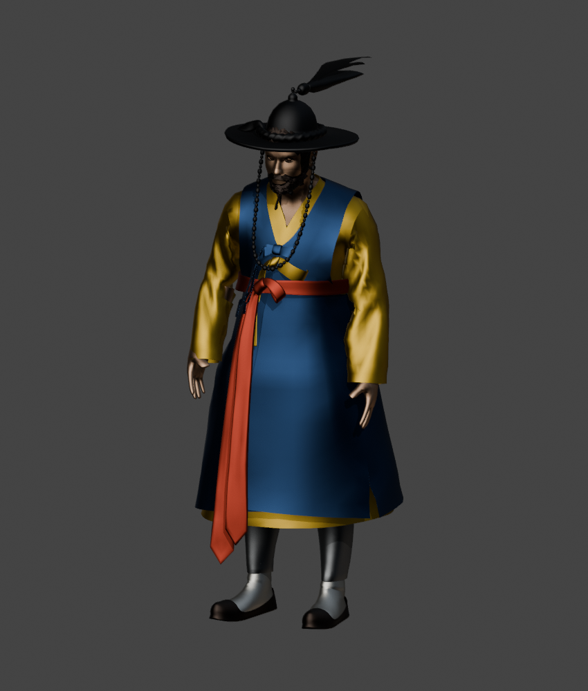
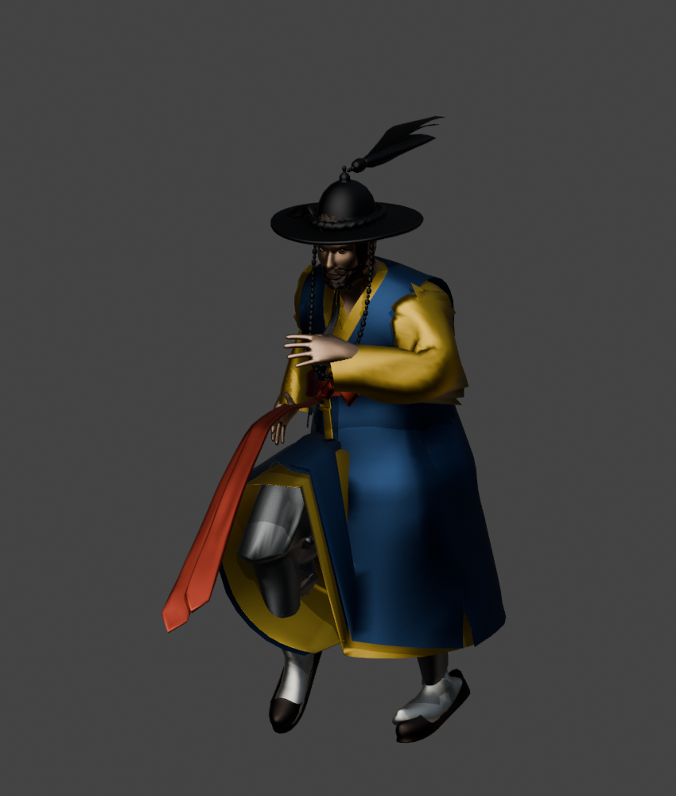

# 이순신 NPC 제작과 사용

PR #121의 이순신 캐릭터를 기반으로 만든 NPC 사본이다. 원본 83본을 보존하고 NPC 소유 스켈레톤에 앞띠용 4본만 추가해 총 87본으로 구성했다. 의상의 다리 관통은 옷자락의 웨이트와 기준 형상의 여유 공간을 수정했다. 기본 대기는 허리·등·목의 기울기를 분산하고 양발을 고정한 별도 동작으로 제작했다. 원본 메시, 스켈레톤, 애니메이션은 보존한다.

## 사용할 에셋

Content Browser의 `/Game/Chae_Asset/YiSunSinContent/NPC/Blueprints/BP_YiSunSin_NPC`를 배치한다. 비교 맵은 `/Game/Chae_Asset/YiSunSinContent/NPC/Preview/L_YiSunSin_NPC_Preview`다.

| 경로 | 역할 |
| --- | --- |
| `NPC/Characters/SK_YiSunSin_NPC_Sash` | 수정한 의상과 원본 재질 9개, NPC 소유 87본 Skeleton |
| `NPC/Characters/SK_YiSunSin_NPC_Sash_Skeleton` | 원본 83본과 NPC 앞띠 4본, 공유 원본과 분리 |
| `NPC/Animations/AS_YiSunSin_NPC_Sash_Idle_Upright` | 발이 고정된 기본 대기와 미세한 앞띠 움직임, 4.84초 루프 |
| `NPC/Animations/AS_YiSunSin_NPC_Sash_Walk`, `..._Run` | 원본 몸 트랙·재생 시간을 보존하고 앞띠 트랙만 추가 |
| `NPC/Animations/BS_YiSunSin_NPC_Sash` | 속도 0 / 150 / 450 cm/s에서 대기 / 걷기 / 달리기 |
| `NPC/Animations/ABP_YiSunSin_NPC_Sash` | 소유 액터의 이동 속도를 소비하는 단순 Blend Space 그래프 |
| `NPC/Blueprints/BP_YiSunSin_NPC` | native Character 기반 NPC, 플레이어 자동 빙의 비활성화, AIController 사용 |

플레이어 BP를 부모로 삼지 않는다. AI 이동 명령으로 CharacterMovement를 움직이면 그 속도로 지상 애니메이션을 선택한다. 기본 이동 속도는 150 cm/s다. 앞띠 4본의 움직임은 애니메이션에 구워 넣었다. 모션매칭, 실시간 리타깃, Cloth solver는 사용하지 않는다. 점프 원본은 의상 검수에 포함했으며 앞띠 버전의 지상 Blend Space에 점프 전환을 추가하지는 않았다.

`SK_YiSunSin_NPC`, `BS_YiSunSin_NPC_Ground`, `ABP_YiSunSin_NPC`는 앞띠 추가 전 비교용으로 남아 있다. 현재 배치 BP와 비교 맵은 `Sash` 버전을 사용한다.

원본 ABP의 Skeleton 연결 누락, 포즈 출력 단절, 속도 입력 누락과 원본 Blend Space의 범위 밖 샘플은 NPC 소유 자산에서 바로잡았다. PR의 원본 ABP와 Blend Space는 수정하지 않았다. `USWNpcAnimInstance`가 게임 스레드에서 소유 액터의 수평 속도를 읽고, ABP의 Blend Space X 입력에 전달한다. 소유자가 없는 미리보기는 속도 0으로 처리한다.

## 제작 원본

`YiSunSin_NPC.blend`를 열면 `NPC_Sash_Idle_Upright`가 기본으로 표시된다. `03_NPC_Working`의 `SK_YiSunSin_NPC`와 `Armature`가 작업 대상이다. Blender 작업 메시 이름은 유지하며 UE에서는 `SK_YiSunSin_NPC_Sash`로 임포트한다.

- `01_Source_Reference`: Unreal에서 내보낸 원본 그대로의 Blender 해석.
- `02_Animation_Reference`: 원본 네 동작. 루트 트랙을 샘플링할 때 이 컬렉션의 평가를 비활성화하지 않는다.
- `03_NPC_Working`: 원본 루트 웨이트를 복원한 대조 메시, 작업 메시와 NPC 87본 Armature.
- `04_UE_RoundTrip_Verification`: 실제 Unreal 재임포트 뒤 다시 내보낸 비교 메시.
- `Reference`: UE 5.7.4에서 내보낸 원본 FBX와 재임포트 비교 FBX.
- `FBX`: 수정 메시, 변경 없는 대조 메시와 NPC 대기 동작의 수출 파일.
- `Audit`: 최종 검증 수치와 제작 설정.
- `Preview`: 형상 검수용 단색 재질 미리보기. 게임에서는 원본 UE 재질을 사용한다.

## 골격과 의상 계약

원본 `spine` 루트를 포함한 83본의 이름·부모·기준 변환을 유지한다. Manny 이름으로 변경하거나 공유 Skeleton의 reference pose를 덮어쓰지 않는다. 추가한 `npc_sash_01`~`04`는 NPC 스켈레톤에만 존재하며 첫 본은 `spine`의 자식이다. 원본 스킨 바인드 자세와 게임의 기본 대기 자세는 구분한다. 자세 개선은 NPC 소유 대기 동작에서 적용한다.

Blender의 FBX importer는 UE의 `Root` 노드를 Armature object로 표현하면서 그 루트의 스킨 웨이트를 가져오지 않았다. 원본 FBX의 7,070개 루트 influence와 잔여 웨이트를 대조해 복원했다. 같은 이름의 루트 본을 작업 Armature에 만들고, 원래 최상위 가지들을 그 아래에 보존했다. 원본 FBX의 root/object 애니메이션은 이 본의 트랙으로 변환했다. 애니메이션 import와 mesh import의 `thumb_03_R` 연결 플래그 차이도 작업 리그에서 일치시켰다.

의상은 동다리와 전복의 몸통·옷자락만 수정했다. 다리 스킨을 삼각형 보간으로 참조하고, 허리에서 원래 상체 웨이트로 부드럽게 연결한다. 긴 밑단에 발목·발가락 회전을 그대로 복사하지 않도록 donor 높이를 제한했다. 하체 옷의 두 겹에 각각 여유를 주고 허리의 작은 잔여 관통을 보정했다. 몸·다리 면을 삭제하거나 본 스케일을 0으로 만들지 않는다. 옆트임과 밑단을 통해 보여야 하는 바지는 남긴다.

대기 자세의 다리와 신발은 기준 자세로 고정한다. 원본 상체의 미세한 움직임을 유지하면서 등·목에 각도 보정을 분산하고 마지막 구간을 첫 자세로 연결한다. 이를 위해 원본 Idle을 덮어쓰지 않는다.

앞띠의 두 갈래 1,280정점만 네 본에 부드럽게 배분하고 매듭·허리띠 928정점은 원래 루트 고정을 유지했다. 아랫부분에는 최대 8.5 cm의 제작 여유를 줬다. 첫 본은 허리 매듭 높이 1.25 m에서 시작하며, 두 갈래 띠의 웨이트는 1.25~1.15 m 구간에서 원래 루트 고정과 새 본 사이를 부드럽게 연결한다. 걷기·달리기에는 10 cm의 전방 여유를 본 트랙에 포함하고 대기에는 적용하지 않는다. 위쪽이 먼저 반응하고 아래쪽이 늦게 휘도록 주기와 위상을 분산했다. 다리가 들리면 옷 앞면을 기준으로 띠를 바깥으로 들어 올리고 다음 본들은 반대로 휘어 끝이 과하게 뻗는 것을 줄인다. 이는 지상 동작에 맞춰 구운 보정이며 임의의 바람·외부 충돌에 반응하는 물리 시뮬레이션은 아니다.

Blender FBX의 `Armature` object 변환은 UE 메시의 bind 행렬에는 반영되지만 애니메이션 임포트에서는 제거된다. 대기 동작은 임포트 직후 로컬 루트 키에 원본 메시의 bind 루트 변환을 합성한다. 이 변환을 누락하면 대기 루트 스케일 1과 걷기 루트 스케일 100이 섞이며 저속에서 축소·기울어짐이 발생한다. `setup_yisunsin_npc.py`는 매번 새로 임포트한 키에 한 번만 보정하며, 저장본 검증에서도 루트 스케일·회전을 검사한다. 공유 Skeleton은 변경하지 않는다.

## 편집과 재임포트

1. 현재 blend를 백업하고 작업 메시를 편집한다. 원본 비교 컬렉션과 공유 골격을 보존한다.
2. 골격과 앞띠를 다시 생성하려면 `author_yisunsin_sash.py`, `fit_yisunsin_sash_motion.py`, `finish_yisunsin_sash.py`를 순서대로 실행한다. 수동으로 다듬은 앞띠를 보존할 때는 이 제작 단계들을 다시 실행하지 않는다.
3. `Scripts/Blender/export_yisunsin_sash.py`로 NPC 메시와 세 동작을 별도로 내보낸다. 원본·앞띠 이전 대조 FBX는 보존한다.
4. 에디터 타깃을 빌드해 `USWNpcAnimInstance`와 `USWNpcAuthoringLibrary`가 로드되는 상태에서 `Scripts/Editor/setup_yisunsin_sash.py`를 실행한다. NPC 전용 Skeleton에만 새 본을 임포트하고 원본 83본의 기준 변환을 검증한다. Legacy FBX factory와 세션 CVar를 사용하며 프로젝트의 영구 importer 설정을 바꾸지 않는다. 원본 Skeleton에는 쓰지 않는다. 재임포트 때 네 앞띠 본의 기준 위치를 반영하기 위한 reference pose 갱신은 분리된 NPC Skeleton에서만 허용하고, 기존 83본의 기준 변환 보존을 검사한다. 새 PhysicsAsset, 재질·텍스처 임포트는 끈다. 걷기·달리기는 원본 UE의 몸 트랙과 재생 시간을 직접 복사하고 네 앞띠 트랙만 추가한다.
5. `verify_yisunsin_sash.py`로 저장된 참조·BP 컴파일·원본 몸 트랙 보존을 확인한다.
6. 비교 맵에서 에디터의 `validate_yisunsin_sash.py`로 저속을 포함한 실제 AnimGraph 속도 순회를 실행한다. PIE 인스턴스의 검사 바닥과 본 평가 설정만 일시적으로 바꾸며 끝나면 에디터를 열어 둔다.
7. Blender의 `validate_yisunsin_sash.py`는 기록된 UE 포즈와 bind 행렬로 메시를 스키닝해 바지 노출과 앞띠·옷 앞면 사이의 여유를 검사한다.

엔진 실행 중인 작업이나 빌드가 끝난 뒤 다음 엔진 작업을 실행한다. 스킨 메시 FBX 내보내기에는 `-AllowCommandletRendering`을 사용한다. NullRHI와 재질 bake 조합에서 확인한 `MeshObject` assertion을 반복하지 않는다.

원본에서 제작 절차를 재현하려면 Reference FBX를 준비한 새 작업 폴더와 새 Blender 장면에서 `run_yisunsin_pipeline.py`를 사용한다. 이미 제작 blend가 있으면 기본적으로 거부하며, 백업 후 `--replace-generated-yisunsin`을 명시해야 재생성할 수 있다. 기존 제작 blend에서 수동으로 수정한 내용을 재생성 도구가 자동으로 병합하지는 않는다.

## 검증 범위

- UE 5.7.4 및 Blender 5.2.3 LTS. 원본 네 동작 총 207프레임에서 원본 포즈와 작업 리그의 본 위치 오차 최대 약 0.0034 mm, 회전 오차 0으로 확인했다.
- 새 기본 대기 122프레임의 신발 최저 높이는 약 0이며, 루프 처음·끝 메시 위치 차이는 0.001 mm 미만이다.
- 기준 높이 0.68 m 위 바지 삼각형의 5개당 1개 중심점을 네 방향으로 검사했다. 원본 네 동작의 노출 표본 합계 2,893개가 수정본에서 0개였고, 새 대기 122프레임도 0개였다. 이 검사는 옆트임을 포함한 한정된 가시성 검사이며 모든 표면의 무교차를 증명하지 않는다. 무릎과 밑단은 별도 렌더 표본으로 확인했다.
- 실제 UE 재임포트 후 다시 내보낸 64,211정점의 위치 차이는 최대 약 0.00026 mm, 웨이트 차이는 최대 약 0.000022였다. 83본의 이름·부모와 기준 변환도 대조했다.
- 에디터 C++ 빌드와 설정 도구 재실행을 통과했다. 새 프로세스에서 저장된 NPC 참조와 BP 컴파일을 확인했고, 전체 에디터 시뮬레이션에서 대기·걷기·정지·달리기를 반복했다. 최고 속도 450 cm/s, 발 본의 컴포넌트 좌표 변화 최대 약 73.2 cm로 실제 이동과 애니메이션 평가를 확인했다. 세부 표본은 `Audit/runtime_smoke.json`에 기록했다.

의상 웨이트와 형상을 고친 제작 데이터 수정이다. 정리나 감시로 관통을 가리는 방식은 아니다. 신규 동작과 극단 자세, LOD 전환은 해당 자산을 추가할 때 다시 검수한다.

저속 보간 회귀 검증: 속도 0·1·10·25·50·75·100·125·149·150·225·300·450과 감속 구간에서 실제 AnimGraph 포즈 240개를 기록했다. 루트 스케일은 약 99.99999~100.00001로 유지됐다. 이 실제 UE 포즈로 메시를 다시 스키닝한 검사에서 무릎 위 바지 노출 표본은 합계 0개였다. `Audit/ue_blend_samples.json`과 `Audit/blend_geometry_validation.json`이 이 검증 결과이며, 종전 이동 여부 검사인 `runtime_smoke.json`보다 넓은 속도 범위를 다룬다.

제작 기준은 참조 프로젝트의 `Character_Rigging_And_UE5_Postprocess_Playbook.md`와 `HumanoidSkeletonRetargetingStandards.md`에서 단위·bind·변형 검수·공유 골격 보존 원칙을 적용했다. 참조 프로젝트의 플레이어 런타임 구조를 이 NPC에 복제하지 않았다.

## 앞띠 최종 검증

현재 NPC는 원본 83본과 분리된 87본 스켈레톤을 사용한다. 기존 83본의 기준 위치 오차는 최대 약 0.0000015 cm다. 걷기·달리기의 몸 트랙은 원본 UE 데이터를 복사했으며 비교한 포즈의 위치 오차는 최대 약 0.00000016 cm, 회전 오차는 약 0.000089도였다. 재생 시간도 원본 그대로다.

속도 0·1·10·25·50·75·100·125·149·150·225·300·450과 감속 단계를 실제 NPC AnimGraph에서 순회했다. 단계마다 최소 15개, 총 240개 포즈를 확보했다. 앞띠 첫 본의 루트 대비 회전 범위는 대기 약 2.2도, 걷기 약 24.0도, 달리기 약 22.2도로 별도 움직임을 확인했다.

검사 범위는 고정 매듭 아래의 움직이는 띠 전체(기준 높이 1.15 m 미만)다. 포즈마다 939정점, 1,652개 면 중심, 2,587개 모서리 중점에서 옷·바지·발목·신발의 앞면과 간격을 검사했다. 총 1,242,720개 위치 표본에서 앞면 안으로 들어간 표본은 0개였고, 최소 여유는 약 1.7 cm였다. 무릎 위 바지 노출 검사도 0개였다. 이는 기록된 동작·속도·포즈에 대한 검사이며 임의의 신규 동작이나 LOD의 모든 표면 교차를 보장하지는 않는다. 고정 매듭과 허리띠의 원래 부착 영역은 그대로 보존했다.

최종 결과는 `Audit/sash_saved_assets_validation.json`, `Audit/sash_runtime_validation.json`, `Audit/sash_geometry_validation.json`에 있다. 재생성 가능한 대용량 원시 본 포즈는 저장소에 추가하지 않고 `Saved/IntegrationChecks/YiSunSin/sash_runtime_samples.json`에 둔다.

