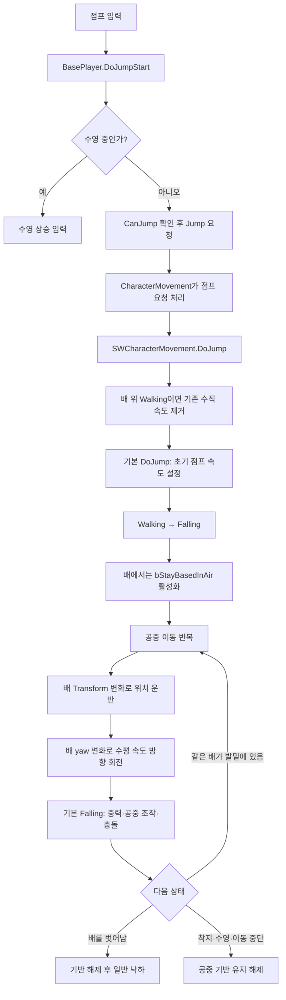
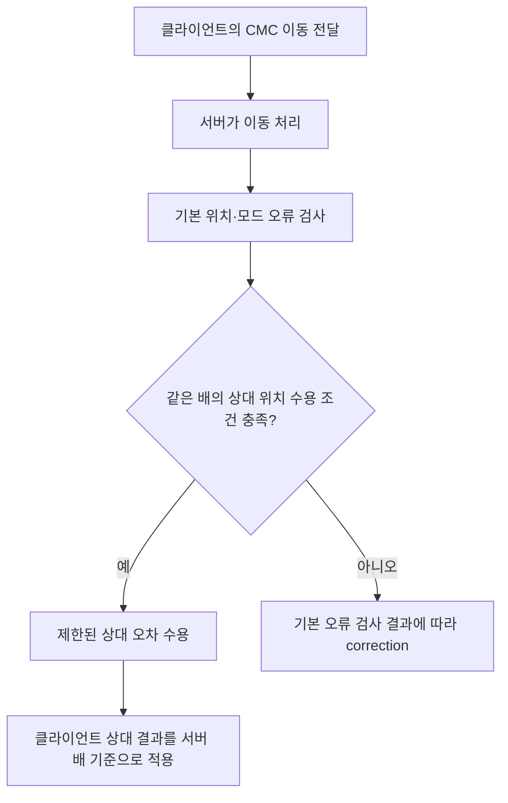

# 배 위에서 자연스러운 점프를 만드는 이동 파이프라인

작성일: 2026-10-11  
대상: UE 5.7 / `ABasePlayer` / `USWCharacterMovementComponent`  
기준: 현재 적용된 간단한 점프 리팩터링

## 1. 구현의 핵심

배가 이동하는 효과와 플레이어가 점프하는 효과를 서로 다른 경로로 처리했다.

**배는 플레이어의 위치를 운반하고, 플레이어의 속도는 자신의 점프와 조작을 표현한다.** 배의 속도를 플레이어의 점프 속도에 더하지 않으면서, 공중에서도 배를 이동 기준으로 유지한다.

현실에서는 공중에 뜬 사람이 배의 가속과 회전을 계속 따라가지 않는다. 이번 구현은 배 위에서 같은 입력이 비슷한 조작 결과를 만드는 것을 우선한다. 사용자는 적용 후 점프가 게임에서 자연스럽게 느껴진다고 확인했다.

완전히 새로운 점프 시스템을 작성한 것이 아니라 기존 CharacterMovement의 점프, Falling, 기반 이동, 착지, 네트워크 예측을 확장했다.

## 2. 전체 흐름



그림의 반복 구간은 역할을 설명한다. 실제 실행은 엔진의 일반 이동 Tick과 물리 이후 기반 이동 갱신에 나뉠 수 있다. 사용자 입력 이벤트에서 배의 위치를 직접 갱신하는 구조는 아니다.

## 3. 입력: 기존 Jump 요청을 유지한다

입력 진입점은 `ABasePlayer::DoJumpStart()`다.

1. 수영 중이면 점프 대신 수영 상승 입력을 처리한다.
2. `CanJump()`가 허용하면 `Jump()`를 호출한다.
3. 점프 애니메이션 이벤트를 전달한다.
4. 버튼을 놓으면 `DoJumpEnd()`에서 `StopJumping()`을 호출한다.

`Jump()`는 점프 의도를 설정하는 경로다. 실제 속도와 이동 모드는 CharacterMovement가 요청을 처리할 때 변경한다. 따라서 이번 변경은 입력 함수에서 `LaunchCharacter`를 호출하거나 위치를 직접 바꾸는 방식으로 구현하지 않았다.

`Server_NotifyJumpStarted()`는 기존 애니메이션 알림 경로다. 점프 이동 자체는 CharacterMovement의 이동 예측·서버 처리 경로를 사용한다. 입력 알림과 실제 점프 승인 시점은 구분해야 한다.

## 4. 점프 시작: 초기 수직 속도를 일정하게 만든다

변경 지점은 `USWCharacterMovementComponent::DoJump(bool, float)`다.

추가 처리를 적용하는 조건은 현재 `MOVE_Walking`이고 MovementBase의 소유자가 `AShip`인 경우다. 육지 및 다른 플랫폼의 점프는 기본 구현으로 전달한다.

배 위 점프에서는 기존 속도를 중력 방향에 수직인 평면으로 투영한다.

```cpp
const FVector PreviousVelocity = Velocity;
Velocity = FVector::VectorPlaneProject(Velocity, GetGravityDirection());
```

현재 월드 수직 중력에서는 수평 이동 속도를 남기고 기존 수직 속도를 제거하는 효과다. 이어서 기본 `DoJump()`가 `JumpZVelocity`를 적용한다.

기본 엔진은 첫 점프에서 기존 수직 속도와 점프 설정값 중 큰 값을 사용할 수 있다. 먼저 기존 수직 성분을 제거했기 때문에, 출발 순간의 상승 속도가 점프 높이를 추가로 키우지 않는다. 기본 점프가 실패하면 보관한 속도를 복구한다.

걷기와 달리기의 수평 속도는 유지한다. 그래서 걷기 점프와 달리기 점프의 거리를 강제로 같게 만드는 구현은 아니다. 기존 점프 횟수·버튼 유지 시간·공중 제어 설정도 유지한다.

## 5. 관성 전달: 배 속도를 점프 속도에 더하지 않는다

변경 지점은 `GetImpartedMovementBaseVelocity()`다.

기본 CharacterMovement는 이동 발판을 떠날 때 발판의 선속도와, 설정에 따라 회전에서 발생하는 접선 속도를 플레이어에게 전달한다. 이 속도가 점프 속도에 섞이면 배 속도와 배 위 출발 위치에 따라 점프 결과가 달라질 수 있다.

이번 구현은 기반의 소유자가 배이면 전달할 속도를 0으로 반환한다.

```cpp
if (Base && Base->GetOwner()->IsA<AShip>())
{
    return FVector::ZeroVector;
}
```

배의 이동은 다음 단계의 기반 이동으로 따로 반영한다. 따라서 배 이동을 위치 운반과 속도 가산으로 중복 적용하지 않는다. 공중에서 배를 벗어나 기반이 해제될 때도 배 속도가 갑자기 추가되지 않는다.

이 처리는 배에서 떠나는 경로에 적용되므로 점프뿐 아니라 가장자리에서 떨어지는 경우에도 영향을 준다.

## 6. 상태 전환: 공중에서도 배를 기반으로 유지한다

변경 지점은 `OnMovementModeChanged()`다.

기본 점프가 `Walking → Falling`을 일으키면, 부모 구현을 호출하기 전에 다음 조건을 검사한다.

- 이전 모드가 Walking이다.
- 현재 기반의 소유자가 배다.
- 사망 상태의 플레이어 이동이 아니다.

조건을 만족하면 `bStayBasedInAir=true`로 설정한다. 이 순서가 중요하다. 부모 구현은 Falling에 진입할 때 이 값을 보고 기존 기반을 유지할지, 기반을 해제하며 속도를 전달할지 결정한다.

이제 플레이어는 Falling 상태라서 중력과 공중 조작을 받으면서도, 배를 MovementBase로 유지한다. 점프 버튼을 누르지 않고 갑판 가장자리에서 Falling으로 전환하는 경우에도 같은 조건이 적용된다.

### 점프 정점에서 기반을 잃지 않게 한다

엔진은 공중의 플레이어 아래로 바닥 질의를 수행해 같은 배가 계속 있는지 확인한다. 질의 길이가 너무 짧으면 점프 정점에서 배가 감지되지 않아 기반이 해제될 수 있다.

이를 막기 위해 필요한 질의 길이를 계산한다.

```text
예상 점프 높이 = JumpZVelocity² / (2 × |GravityZ|)
필요 질의 길이 = 예상 점프 높이 + MaxStepHeight + 50cm
사용 길이 = max(기존 StayBasedInAirHeight, 필요 질의 길이)
```

이 식은 일정한 중력과 초기 속도만 고려한 기본 정점 높이다. 버튼 유지에 따른 추가 상승이나 외부 힘까지 정확하게 계산하는 것은 아니다. 기존 질의 길이를 줄이지 않고 필요한 경우 늘리는 용도로 사용한다.

## 7. 공중 반복: 배의 위치 변화와 플레이어 이동을 합성한다

변경 지점은 `UpdateBasedMovement()`다.

### 7.1 배가 움직인 만큼 위치를 운반한다

먼저 부모의 `UpdateBasedMovement()`를 호출한다. 엔진이 이전 배 Transform과 새 배 Transform을 비교해 플레이어 위치를 갱신한다.

개념적으로는 다음과 같다.

```text
새 플레이어 위치 ≈ 배 Transform 변화로 운반된 위치
                 + 플레이어 자신의 이동 결과
```

정확한 실행 순서와 충돌 처리는 엔진에 맡긴다. 새 코드는 플레이어를 배 Actor에 Attach하거나 매 프레임 별도로 순간이동시키지 않는다.

현재 프로젝트는 이미 `bBaseOnAttachmentRoot=true`를 설정하고 있다. 갑판 충돌 메시에서 실제 물리 attachment root로 기반을 잡는 기존 구조를 그대로 사용한다.

### 7.2 배가 회전하면 수평 이동 방향도 회전시킨다

위치만 배를 따라가고 플레이어의 수평 속도 방향은 월드에 고정되어 있으면, 회전하는 배에서 이동 방향이 상대적으로 틀어질 수 있다.

이번 구현은 부모 갱신 전의 배 회전과 갱신 후의 배 회전에서 yaw 차이를 구해 속도를 회전한다.

```cpp
const float YawDelta =
    (BaseRotation * PreviousBaseRotation.Inverse()).Rotator().Yaw;
Velocity = FRotator(0.0f, YawDelta, 0.0f).RotateVector(Velocity);
```

Falling이고 공중 기반 유지가 켜져 있으며, 부모 갱신 후에도 같은 배 기반이 남아 있을 때만 적용한다. yaw 회전이므로 수직 속도는 유지된다. 배의 pitch/roll에 따라 중력이나 전체 속도를 회전시키는 구현은 아니다.

기존 사망 래그돌의 위치 보정 처리는 유지했다. 배 점프용 회전 처리는 살아 있는 플레이어의 기반 유지 조건과 연결된다.

## 8. 종료: 착지와 배 이탈을 기존 엔진 흐름에 연결한다

### 같은 배가 발밑에 남아 있는 경우

엔진의 기반 유지 질의가 같은 attachment root를 감지하면 배 추종을 계속한다. 플레이어 자신의 Falling 이동은 중력, 공중 입력, 벽·천장 충돌을 처리한다.

### 배를 벗어나는 경우

바닥 질의에서 같은 배가 감지되지 않으면 엔진은 MovementBase를 해제한다. 이때 기반 속도 전달 함수가 배에 대해 0을 반환하므로 별도 배 관성 없이 일반 낙하를 이어간다.

구현상 `bStayBasedInAir` 자체는 Falling이 끝날 때까지 남을 수 있지만, 기반이 없으면 운반할 배도 없다. 별도의 배 로컬 경계 볼륨은 추가하지 않았다.

### 착지·수영·이동 중단

Falling이 아닌 모드로 바뀌면 `bStayBasedInAir=false`로 해제하고 부모의 정상 상태 전환을 실행한다. 실제 착지 면으로 기반을 다시 잡는 처리와 수영 전환은 기존 시스템을 사용한다.

## 9. 네트워크: 배 위 상대 위치를 조건부로 수용한다

배의 위치는 Network Physics가 예측하고, 플레이어 이동은 CharacterMovement가 예측한다. 이번 변경은 이 두 시스템을 하나의 물리 시뮬레이션으로 합치지 않았다.

공중에서도 배 기반이 남아 있으므로 기존 배 상대 위치 검증을 점프에 확장할 수 있었다.



`CanUseShipBasedClientPosition()`의 주요 조건은 다음과 같다.

- 서버가 Walking이거나, 기반을 유지한 Falling 상태다.
- 서버와 클라이언트의 packed movement mode가 같다.
- 두 기반의 소유자가 같은 배다.
- 기반 Bone 이름이 같고 두 기반 모두 상대 위치를 사용할 수 있다.
- 서버 위치를 배 기준으로 변환한 결과와 클라이언트 상대 위치의 차이가 허용 범위 이하다.

허용 상대 오차의 C++ 기본값은 `ShipBasedClientAuthorityMaxError=15cm`다. 실제 값은 Blueprint 설정에 따라 달라질 수 있다.

조건을 만족하면 `ServerExceedsAllowablePositionError()`가 상대 위치를 이유로 보정을 생략할 수 있고, `ServerShouldUseAuthoritativePosition()`이 클라이언트 결과를 수용하도록 한다. 이름에 AuthoritativePosition이 들어 있지만 이 확장의 역할은 **검사 조건을 통과한 클라이언트 위치를 서버가 받아들이는 것**이다.

이 처리는 같은 배의 제한된 상대 위치 차이를 흡수하는 정책이다. 과거 배 프레임을 일치시키거나 클라이언트 이동을 완전히 신뢰하는 새 시스템은 아니다. 기존의 ‘배 위에서 시작한 Falling이면 무조건 위치 correction 생략’ 분기는 제거했다.

기존 saved move, jump 입력 플래그, 서버 이동 처리를 유지했으며 새 점프 전용 RPC나 추가 jump payload는 도입하지 않았다. 과거 배 Transform에 대한 충돌 재생은 구현 범위에 포함되지 않는다.

## 10. 자연스러운 조작감으로 이어지는 이유

| 플레이어가 느끼는 변화 | 구현상 이유 |
| --- | --- |
| 배의 상승 움직임이 점프 출발 속도를 키우지 않음 | 첫 배 점프에서 기존 수직 속도를 제거 |
| 배 속도 때문에 앞으로 발사되는 현상 감소 | 기반 선속도·회전 접선 속도의 전달 차단 |
| 제자리 점프 중 배가 아래에서 빠져나가는 현상 감소 | 공중에서도 배 기반 이동 유지 |
| 회전하는 배에서 이동 방향이 상대적으로 유지됨 | 수평 속도를 배 yaw 변화로 회전 |
| 배 밖으로 나갈 때 추가 관성 충격이 없음 | 기반 해제 시에도 배 전달 속도는 0 |
| 작은 배 위치 차이로 플레이어가 반복 보정되는 현상 완화 가능 | 같은 배·같은 모드의 제한된 상대 위치 차이 수용 |

사용자가 확인한 자연스러운 조작감은 이러한 규칙의 결과다. 각 항목의 개선량을 자동화 시험으로 계측한 것은 아니다.

## 11. 이번 구현의 범위와 검증 기록

수정한 게임 코드는 `SWCharacterMovementComponent.cpp`와 `.h`다. 입력 함수, 배의 Network Physics, Net Update Frequency, 별도 custom movement mode는 새로 변경하지 않았다.

에디터 빌드는 통과했고 자동화 테스트는 사용자 요청에 따라 생략했다. 이후 사용자가 현재 점프의 조작감이 자연스럽다고 확인했다. 네트워크 지연·손실·다중 클라이언트 조건의 정량 검증 완료와는 구분한다.

이번 구현은 월드 수직 중력과 배 Transform 추종을 함께 사용한다. 따라서 큰 배 기울기, 외부 장애물, 긴 점프 hold, 큰 네트워크 오차에서 배 기준 높이와 착지 위치가 항상 동일하다고 보장하지 않는다. 배 관성 전달을 분리하면서 기존 엔진 이동 파이프라인을 최대한 활용한 간단한 구현이다.

## 12. 코드 탐색 순서

아래 링크는 이 문서 기준 상대 경로다.

1. [BasePlayer.cpp](../Source/ClassFeature/Private/BasePlayer.cpp): `DoJumpStart`, `DoJumpEnd`, 기존 attachment root 설정.
2. [SWCharacterMovementComponent.cpp](../Source/ClassFeature/Private/SWCharacterMovementComponent.cpp): `DoJump` → `OnMovementModeChanged` → `UpdateBasedMovement` → `GetImpartedMovementBaseVelocity`.
3. 같은 파일의 `CanUseShipBasedClientPosition`, `ServerExceedsAllowablePositionError`, `ServerShouldUseAuthoritativePosition`: 상대 위치 검증과 수용.
4. [SWCharacterMovementComponent.h](../Source/ClassFeature/Public/SWCharacterMovementComponent.h): override 선언과 상대 오차 설정.
5. [수동 확인 안내](Player_Ship_Jump_Refactor.md): 적용 범위와 플레이 확인 순서.
6. [전체 설계 계획](../Planning/Network%20Physics/Player_Ship_Independent_Jump_Plan_2026-10-11.md): 완전한 배 로컬 점프와 물리 프레임 재생을 포함한 후속 설계.

엔진 내부 흐름은 설치된 UE 5.7의 `CharacterMovementComponent.cpp`에서 `DoJump`, `OnMovementModeChanged`, `ApplyImpartedMovementBaseVelocity`, `UpdateBasedMovement`를 순서대로 읽으면 확인할 수 있다.
